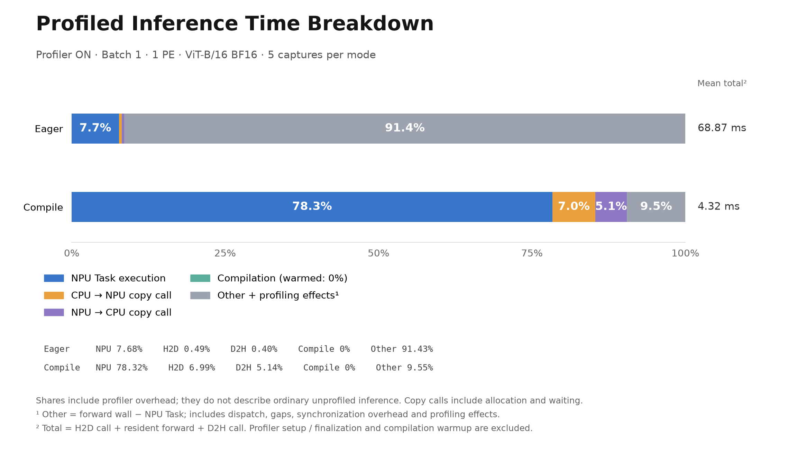
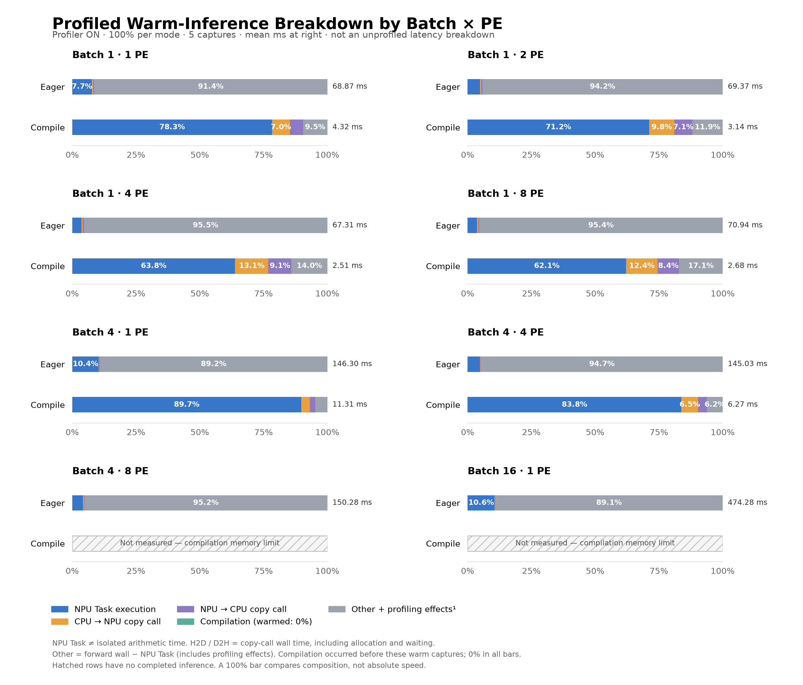

# ViT batch × PE 추가 프로파일링

작성·갱신: 2026-11-25 04:03 KST. 원본 실험: `20261118T081725Z-a6c274`. 추가 실행: `20261124T181821Z`.

실제 시도 이력이 있는 **8개 batch×PE 조합 / 16개 Eager·Compile 조건**을 대상으로 한다. 추가 실행 성공 14/16개. 순수 연산 유닛 시간은 현재 SDK trace에서 확인되지 않아 추정하지 않는다. 주 결과는 **장치 NPU Task 실행 시간**이다.

상태 집계: `ok` 14개, `resource_limit` 2개.

## 1. 기존 실험 조건 전체 목록

계획된 조합은 36개(PE 1·2·4·8 × batch 1·4·8·16·32·64·128·256·512), Eager/Compile 72개다. 이 중 실제 worker를 시작한 8개 조합을 이번에 프로파일링한다. 계획만 있었던 조합은 실행했던 실험으로 계산하지 않는다.

| Batch | 1 PE | 2 PE | 4 PE | 8 PE |
| --- | --- | --- | --- | --- |
| 1 | 정식 E/C 완료 | 정식 E/C 완료 | 정식 E/C 완료 | 정식 E/C 완료 |
| 4 | 정식 E/C 완료 | 미시작 | 정식 E/C 완료 | 실제 시도 — 아래 표 참조 |
| 8 | 미시작 | 미시작 | 미시작 | 미시작 |
| 16 | 실제 시도 — 아래 표 참조 | 미시작 | 미시작 | 미시작 |
| 32 | 미시작 | 미시작 | 미시작 | 미시작 |
| 64 | 미시작 | 미시작 | 미시작 | 미시작 |
| 128 | 미시작 | 미시작 | 미시작 | 미시작 |
| 256 | 미시작 | 미시작 | 미시작 | 미시작 |
| 512 | 미시작 | 미시작 | 미시작 | 미시작 |

| PE | Batch | 모드 | 기존 시도 수 | 기존 상태별 건수 | 성공 단계 |
| --- | --- | --- | --- | --- | --- |
| 1 | 1 | compile | 10 | ok:8, error:2 | diagnostic, exploration, formal, stabilization |
| 1 | 1 | eager | 10 | ok:8, error:2 | diagnostic, exploration, formal, stabilization |
| 1 | 4 | compile | 8 | ok:8 | exploration, formal, stabilization, validation |
| 1 | 4 | eager | 8 | ok:8 | exploration, formal, stabilization, validation |
| 1 | 16 | compile | 1 | interrupted:1 | 없음 |
| 1 | 16 | eager | 1 | ok:1 | validation |
| 2 | 1 | compile | 7 | contaminated:1, ok:6 | diagnostic, exploration, formal, stabilization |
| 2 | 1 | eager | 6 | ok:6 | diagnostic, exploration, formal, stabilization |
| 4 | 1 | compile | 7 | ok:6, error:1 | diagnostic, exploration, formal, stabilization |
| 4 | 1 | eager | 7 | ok:6, error:1 | diagnostic, exploration, formal, stabilization |
| 4 | 4 | compile | 8 | ok:5, contaminated:1, error:2 | formal, stabilization, validation |
| 4 | 4 | eager | 7 | ok:5, error:2 | formal, stabilization, validation |
| 8 | 1 | compile | 6 | ok:6 | diagnostic, exploration, formal, stabilization |
| 8 | 1 | eager | 6 | ok:6 | diagnostic, exploration, formal, stabilization |
| 8 | 4 | compile | 1 | timeout:1 | 없음 |
| 8 | 4 | eager | 2 | ok:2 | exploration, validation |

이전 pilot·실제 이미지 후속·attention·fastpath 연구의 batch는 1/4, 기본 1 PE로 위 조건에 포함된다. 초기 합성 입력, native-MHA CPU fallback, Attention-only compile은 실행 경로가 다르므로 이번 수치와 합산하지 않는다. 이번 추가 실험은 최종 PE 확장 실험의 원본 ViT·fastpath-off 경로를 재현한다.

## 2. 측정 방법과 지표

| 항목 | 방법 / 해석 |
| --- | --- |
| 모델·입력 | 원본 ViT-B/16, IMAGENET1K_V1, BF16, 224×224. 가중치·state_dict·입력 hash 확인. B>4는 기존 4장 반복 입력. |
| 설정 | 원본 thread 설정(22/64), MHA fastpath=False, CPU fallback=False, torch.compile backend=furiosa.torch.backend만 지정. PE마다 별도 프로세스. |
| 캐시 | 과거 성공 실행 캐시를 새 case/cache로 복사. 성공 이력이 없는 조건은 과거 중단·timeout 캐시를 복사. 원본 수정 없음. 첫 호출은 캐시 재사용 시작 비용이며 cold compile 시간이 아님. |
| 자원 한도 | 단일 NPU worker, 조건당 3600초. cgroup 메모리 여유 8 GiB 미만이면 자기 worker만 종료하고 resource_limit로 보존. |
| 워밍업·반복 | 정식 이력이 있는 조건 100회, 나머지 20회 warmup 후 5회 프로파일링. 기존 안정화 판정 재검증은 하지 않음. 중앙값·최솟값·최댓값 보고. |
| NPU Task ms | forward trace에서 begin_cycle/end_cycle/cycle_actual이 있는 ::Task:: 구간만 선택. 여러 cluster의 겹친 구간은 합집합으로 계산. CPU export/compile/submit/synchronize span, 외부 H2D/D2H와 profile_d2h는 제외. |
| 순수 compute ms | NPU Task 내부 연산·내부 DMA·대기의 독립 분리 근거가 없어 미확인. Task 시간을 순수 compute로 표시하지 않음. |
| Forward 잔여 시간 | 같은 capture의 forward wall − NPU Task 합집합. CPU 처리·제출·장치 idle·프로파일링 영향 등의 혼합 잔여값이며 순수 CPU 시간이 아님. |
| Forward wall ms | 입력·가중치가 NPU에 있는 상태의 runner 호출+동일 current stream 완료. profiler 활성 오버헤드 포함. |
| H2D/D2H wall ms | 매 반복 실제 입력 .to(device), 출력 .cpu()를 별도 capture. 메모리 할당·복사 제출·완료 대기를 포함하는 CPU 관측 시간. 순수 DMA와 다름. |
| 전송 device ms | 장치 ::h2d:: 또는 ::d2h:: span이 존재할 때만 집계. SDK 누락은 —로 표기; 0으로 대체하지 않음. |
| Compile API ms | 첫 호출 trace의 compile span 합집합. 캐시 탐색·native compile 경로 등을 포함할 수 있으며 순수 codegen 시간이 아님. |
| 첫 호출 wall ms | graph capture/export/compile/cache/load/첫 NPU 실행을 포함. 반복 추론 시간과 별도. |
| 단위·정확성 | 모든 ms는 배치 1회당 시간. 프로파일링 진단이며 기존 정식 latency와 합산하지 않음. 프로파일 종료·JSON 저장 비용은 구간 wall 타이머 밖. |

## 3. Batch·PE별 장치 실행 시간

단위: ms / 배치 1회. —는 미측정·이벤트 누락을 뜻하며 0이 아니다. 정상 종료와 NPU 타이밍 확보 여부를 별도로 확인한다. PE 열은 SDK Fusion 설정값이며 개별 PE의 가동률을 뜻하지 않는다.

| PE | Batch | Eager NPU Task | Compile NPU Task | Eager forward wall | Compile forward wall | 유효 NPU E/C | 상태 E/C |
| --- | --- | --- | --- | --- | --- | --- | --- |
| 1 | 1 | 5.288 | 3.385 | 69.163 | 3.788 | 5/5 · 5/5 | ok / ok |
| 1 | 4 | 15.202 | 10.153 | 145.616 | 10.634 | 5/5 · 5/5 | ok / ok |
| 1 | 16 | 50.405 | — | 473.039 | — | 5/5 · 0/5 | ok / resource_limit |
| 2 | 1 | 3.394 | 2.234 | 68.763 | 2.597 | 5/5 · 5/5 | ok / ok |
| 4 | 1 | 2.438 | 1.605 | 68.216 | 1.958 | 5/5 · 5/5 | ok / ok |
| 4 | 4 | 6.695 | 5.257 | 143.281 | 5.631 | 5/5 · 5/5 | ok / ok |
| 8 | 1 | 2.599 | 1.660 | 70.515 | 2.095 | 5/5 · 5/5 | ok / ok |
| 8 | 4 | 6.351 | — | 149.176 | — | 5/5 · 0/5 | ok / resource_limit |

### 반복 변동과 잔여 시간

Forward 잔여 시간은 같은 반복의 forward wall에서 NPU Task 시간을 뺀 뒤 중앙값을 구했다. 순수 CPU 비용으로 해석하지 않는다.

| PE | Batch | 모드 | NPU 최소–최대 | Forward 잔여 | Task 수 | Cluster | 비고 / 원본 |
| --- | --- | --- | --- | --- | --- | --- | --- |
| 1 | 1 | compile | 3.385–3.386 | 0.402 | 2–2 | 0 |  [result](cases/p1_b1_compile/result.json) |
| 1 | 1 | eager | 5.287–5.289 | 63.875 | 185–185 | 0 |  [result](cases/p1_b1_eager/result.json) |
| 1 | 4 | compile | 10.151–10.153 | 0.481 | 3–3 | 0 |  [result](cases/p1_b4_compile/result.json) |
| 1 | 4 | eager | 15.194–15.204 | 130.414 | 185–185 | 0 |  [result](cases/p1_b4_eager/result.json) |
| 1 | 16 | compile | — | — | 0–0 | — | cgroup memory headroom <8 GiB; stopped before OOM [result](cases/p1_b16_compile/result.json) |
| 1 | 16 | eager | 50.401–50.407 | 422.638 | 185–185 | 0 |  [result](cases/p1_b16_eager/result.json) |
| 2 | 1 | compile | 2.233–2.235 | 0.363 | 1–1 | 0 |  [result](cases/p2_b1_compile/result.json) |
| 2 | 1 | eager | 3.392–3.395 | 65.369 | 185–185 | 0 |  [result](cases/p2_b1_eager/result.json) |
| 4 | 1 | compile | 1.600–1.606 | 0.352 | 1–1 | 0 |  [result](cases/p4_b1_compile/result.json) |
| 4 | 1 | eager | 2.435–2.439 | 65.777 | 185–185 | 0 |  [result](cases/p4_b1_eager/result.json) |
| 4 | 4 | compile | 5.255–5.258 | 0.375 | 2–2 | 0 |  [result](cases/p4_b4_compile/result.json) |
| 4 | 4 | eager | 6.688–8.067 | 136.526 | 184–185 | 0 |  [result](cases/p4_b4_eager/result.json) |
| 8 | 1 | compile | 1.657–1.668 | 0.433 | 4–4 | 0,1 |  [result](cases/p8_b1_compile/result.json) |
| 8 | 1 | eager | 2.586–2.606 | 67.913 | 370–370 | 0,1 |  [result](cases/p8_b1_eager/result.json) |
| 8 | 4 | compile | — | — | 0–0 | — | cgroup memory headroom <8 GiB; stopped before OOM [result](cases/p8_b4_compile/result.json) |
| 8 | 4 | eager | 6.345–6.360 | 142.831 | 370–370 | 0,1 |  [result](cases/p8_b4_eager/result.json) |

## 4. 전송·컴파일 관련 시간

H2D/D2H는 반복별 데이터 전송이며, 전체 모델 가중치 전송은 최초 준비 구간에만 있다. wall 열은 할당·CPU 처리·대기를 포함한다.

| PE | Batch | 모드 | H2D wall | H2D device (유효/5) | D2H wall | D2H device (유효/5) | 모델+입력 최초 전송 wall | 첫 forward wall | 첫 Compile API |
| --- | --- | --- | --- | --- | --- | --- | --- | --- | --- |
| 1 | 1 | compile | 0.254 | 0.205 (1/5) | 0.217 | — (0/5) | 42.610 | 10075.211 | 128.295 |
| 1 | 1 | eager | 0.311 | — (0/5) | 0.269 | — (0/5) | 39.675 | 6259.182 | 35.155 |
| 1 | 4 | compile | 0.342 | 0.273 (1/5) | 0.240 | — (0/5) | 39.677 | 10334.654 | 138.148 |
| 1 | 4 | eager | 0.363 | — (0/5) | 0.267 | — (0/5) | 38.738 | 7040.268 | 38.224 |
| 1 | 16 | compile | — | — (0/5) | — | — (0/5) | 54.172 | — | — |
| 1 | 16 | eager | 0.891 | — (0/5) | 0.306 | — (0/5) | 40.369 | 7223.867 | 39.478 |
| 2 | 1 | compile | 0.271 | 0.196 (1/5) | 0.229 | — (0/5) | 41.132 | 10103.864 | 120.255 |
| 2 | 1 | eager | 0.311 | — (0/5) | 0.282 | — (0/5) | 39.033 | 6147.471 | 34.204 |
| 4 | 1 | compile | 0.292 | 0.202 (1/5) | 0.220 | — (0/5) | 47.436 | 10032.575 | 112.175 |
| 4 | 1 | eager | 0.307 | — (0/5) | 0.276 | — (0/5) | 43.049 | 6244.417 | 35.009 |
| 4 | 4 | compile | 0.361 | 0.290 (1/5) | 0.213 | — (0/5) | 40.058 | 10145.175 | 126.290 |
| 4 | 4 | eager | 0.354 | — (0/5) | 0.271 | — (0/5) | 38.457 | 7098.069 | 38.412 |
| 8 | 1 | compile | 0.295 | 0.171 (1/5) | 0.223 | — (0/5) | 44.343 | 10080.615 | 125.526 |
| 8 | 1 | eager | 0.314 | — (0/5) | 0.298 | — (0/5) | 41.575 | 6188.792 | 35.477 |
| 8 | 4 | compile | — | — (0/5) | — | — (0/5) | 39.792 | — | — |
| 8 | 4 | eager | 0.387 | 0.199 (5/5) | 0.318 | 0.072 (1/5) | 41.297 | 7037.326 | 39.426 |

### 완료하지 못한 조건

다음 실행은 첫 forward를 완료하기 전에 종료됐다. 아래 경과시간은 준비·컴파일을 포함한 worker 전체 실행 시간(초)이며 NPU 실행 시간이 아니다. 자원 한도는 이 실행 환경의 한계이며 하드웨어·SDK 미지원 판정이 아니다.

| PE | Batch | 모드 | 결과 | Worker 경과(s) | cgroup 사용/한도 | 사유 |
| --- | --- | --- | --- | --- | --- | --- |
| 1 | 16 | compile | resource_limit | 143.112 | 152.22 / 160 GiB | cgroup memory headroom <8 GiB; stopped before OOM |
| 8 | 4 | compile | resource_limit | 243.215 | 152.12 / 160 GiB | cgroup memory headroom <8 GiB; stopped before OOM |

## 5. Graph break·재컴파일 확인

각 프로세스 시작 전 `TORCH_LOGS=graph_breaks,recompiles`, `FURIOSA_TORCH_PROFILE=trace` 설정. 로그 행 수는 사건 수와 다를 수 있다. 실패한 실행의 로그 부재는 미발생 증거가 아니다.

| PE | Batch | 모드 | 상태 | Graph-break 로그 행 | Recompile 로그 사건 | 측정 중 backend 추가 호출 |
| --- | --- | --- | --- | --- | --- | --- |
| 1 | 1 | compile | ok | 0 | 0 | 0 |
| 1 | 1 | eager | ok | 0 | 0 | 0 |
| 1 | 4 | compile | ok | 0 | 0 | 0 |
| 1 | 4 | eager | ok | 0 | 0 | 0 |
| 1 | 16 | compile | resource_limit | 0 | 0 | — |
| 1 | 16 | eager | ok | 0 | 0 | 0 |
| 2 | 1 | compile | ok | 0 | 0 | 0 |
| 2 | 1 | eager | ok | 0 | 0 | 0 |
| 4 | 1 | compile | ok | 0 | 0 | 0 |
| 4 | 1 | eager | ok | 0 | 0 | 0 |
| 4 | 4 | compile | ok | 0 | 0 | 0 |
| 4 | 4 | eager | ok | 0 | 0 | 0 |
| 8 | 1 | compile | ok | 0 | 0 | 0 |
| 8 | 1 | eager | ok | 0 | 0 | 0 |
| 8 | 4 | compile | resource_limit | 0 | 0 | — |
| 8 | 4 | eager | ok | 0 | 0 | 0 |

## 6. 100% 시간 분해 그래프에 사용할 수 있는가?

이번 자료는 입력 전송·resident forward·출력 전송을 순차적으로 측정한다. 그러나 장치 Task 내부 compute/DMA 분리 및 일부 device 이벤트가 미확인이고, compile API는 캐시 재사용 경로다. 따라서 **순수 compute / 순수 H2D DMA / 순수 D2H DMA / 순수 codegen / CPU overhead의 5항목 실측 100% 그래프는 아직 만들 수 없다.** 측정 범위를 명시한 전송 호출 wall / forward wall 비교와 NPU Task 중앙값 표는 사용할 수 있다. 각 항목의 중앙값 합은 요청 총시간의 중앙값과 같지 않을 수 있다.

### 반복 추론 기준 100% 그래프

아래는 순수 compute/DMA/codegen 분해가 아니라, **실제로 측정한 구간의 시간 분해**다. 추가 NPU 실행 없이 성공한 14개 조건·70회 캡처를 사용했다.

- 100%의 분모: 입력 복사 호출 wall + resident forward wall + 출력 복사 호출 wall. 별도 Profiler context의 시작·종료 사이 공백, JSON 저장·출력 검사 등은 제외한다.
- 구성: NPU Task, H2D 호출 wall, D2H 호출 wall, 컴파일 0, forward wall − NPU Task. 같은 반복의 값을 사용하므로 중복 없이 분모에 합산된다.
- 집계: 조건별 5회 구성요소 시간 합 ÷ 같은 5회 전체 시간 합. 각 막대의 총 ms는 평균이다. 앞 표의 중앙값과 구분한다.
- 반복 측정 중 compile span·backend 추가 호출·재컴파일 로그가 없어 컴파일을 0%로 표시했다. 최초 컴파일 비중을 뜻하지 않는다.
- 회색 잔여값에는 CPU 제출, 장치 idle, 동기화의 호스트 비용, profiler 영향 등이 섞여 있다. 모두 CPU 연산 시간으로 해석하지 않는다.
- NPU Task는 내부 DMA/대기를 포함할 수 있고, 전송 호출 wall은 할당·CPU 처리·대기를 포함한다. 순수 연산 또는 순수 DMA 시간으로 바꿔 읽지 않는다.





| PE | Batch | 모드 | 평균 총 ms | NPU Task % | H2D 호출 % | D2H 호출 % | 컴파일 % | Forward 잔여 % |
| --- | --- | --- | --- | --- | --- | --- | --- | --- |
| 1 | 1 | compile | 4.322 | 78.32 | 6.99 | 5.14 | 0.00 | 9.55 |
| 1 | 1 | eager | 68.873 | 7.68 | 0.49 | 0.40 | 0.00 | 91.43 |
| 1 | 4 | compile | 11.312 | 89.75 | 3.43 | 2.12 | 0.00 | 4.70 |
| 1 | 4 | eager | 146.295 | 10.39 | 0.27 | 0.19 | 0.00 | 89.16 |
| 1 | 16 | eager | 474.278 | 10.63 | 0.19 | 0.07 | 0.00 | 89.11 |
| 2 | 1 | compile | 3.139 | 71.18 | 9.83 | 7.11 | 0.00 | 11.88 |
| 2 | 1 | eager | 69.374 | 4.89 | 0.48 | 0.41 | 0.00 | 94.23 |
| 4 | 1 | compile | 2.512 | 63.83 | 13.06 | 9.07 | 0.00 | 14.03 |
| 4 | 1 | eager | 67.310 | 3.62 | 0.48 | 0.41 | 0.00 | 95.48 |
| 4 | 4 | compile | 6.269 | 83.85 | 6.46 | 3.46 | 0.00 | 6.23 |
| 4 | 4 | eager | 145.031 | 4.80 | 0.27 | 0.19 | 0.00 | 94.74 |
| 8 | 1 | compile | 2.675 | 62.11 | 12.39 | 8.41 | 0.00 | 17.09 |
| 8 | 1 | eager | 70.938 | 3.66 | 0.45 | 0.44 | 0.00 | 95.44 |
| 8 | 4 | eager | 150.283 | 4.23 | 0.30 | 0.26 | 0.00 | 95.21 |

[그래프 수치 CSV](breakdown.csv) · [100% 합산 검증](breakdown_verification.json) · [전체 SVG](figures/breakdown_all.svg) · [전체 PDF](figures/breakdown_all.pdf). 반올림한 표의 합은 100%와 0.01%p 차이가 날 수 있다.

### 프로파일링 오버헤드 대조 검증

2026-11-25 KST 추가 검증. 1 PE·batch 1의 같은 프로세스·모델·resident 입력에서 OFF / ON / ON / OFF 순서로 블록당 10회씩 측정했다. 각 모드 OFF 20회, ON 20회이며 외부 입출력 전송은 제외했다. 모델·가중치·thread·캐시·warmup 설정은 원래 추가 프로파일링과 같다.

| 모드 | OFF forward 중앙값 ms | ON forward 중앙값 ms | ON/OFF | 증가율 |
| --- | --- | --- | --- | --- |
| eager | 44.713 | 64.169 | 1.435× | 43.5% |
| compile | 3.649 | 3.755 | 1.029× | 2.9% |

프로파일러 활성화의 영향은 Eager에서 특히 컸다. 따라서 위 100% 그림의 회색 비중을 **프로파일러가 꺼진 실제 추론의 CPU 비용 비중으로 해석하면 안 된다.** NPU Task 시간도 순수 arithmetic 시간으로 분리된 것은 아니다. 정상 여부·최적 성능 여부는 이 그래프만으로 확정할 수 없다.

[대조 실험 원본](profiler_control/summary.json). 각 모드 폴더에 40회 forward wall과 ON 구간 20개 trace, 첫 호출 trace, 모델·입력 hash, 로그를 보존했다. 측정 중 backend 재진입은 두 모드 모두 0회다.

## 7. 재현 및 원본

```bash
cd /root/ViT
/root/venv/bin/python profiling/batch_pe/run.py --run profiling/batch_pe/runs/20261124T181821Z
/root/venv/bin/python profiling/batch_pe/report.py --run profiling/batch_pe/runs/20261124T181821Z
```

그래프 재생성: `vit_pilot/.plot-venv/bin/python profiling/batch_pe/plots.py --run profiling/batch_pe/runs/20261124T181821Z`

[검증 결과](verification.json) · [조건별 CSV](summary.csv) · [반복별 CSV](samples.csv) · [기존 조건 목록](inventory.json) · [장치 정보](device_info.txt). device 전송 타이밍 누락 시 exporter의 `invalid trace reference time` 경고 여부를 원본 로그에서 확인할 수 있다. 이는 실행 0ms를 의미하지 않는다. 각 case에 첫 호출 및 H2D/forward/D2H trace, stdout/stderr, 결과 JSON을 보존한다.

공식 API: [Furiosa Profiler](https://developer.furiosa.ai/furiosa-torch-docs/v2026.4.0/documentation/profile/). 설치 SDK에서 trace 수준은 operator/DMA 상세를 요청하지만 실제 출력에 없는 이벤트는 추정하지 않는다.
