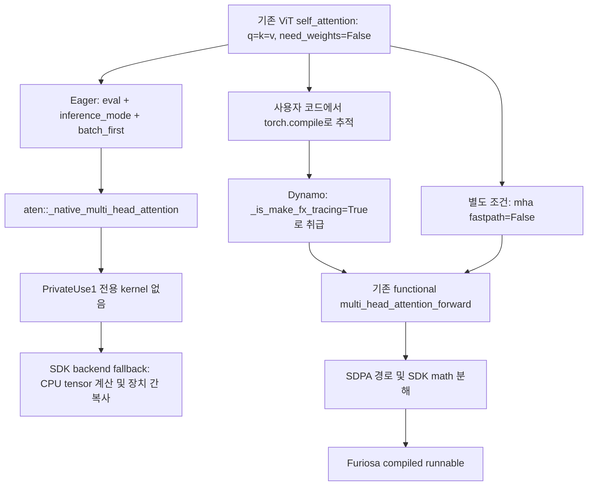

# native MHA fallback의 실행 경로

아래 설명은 설치된 torch 2.10.0+cpu / furiosa-torch 2026.4.0에 한정한다. 다른 SDK 버전에서도 동일하다고 일반화하지 않는다.

- **[소스 확인]** `torch/nn/modules/activation.py:1052`의 `_check_arg_device`는 CPU/CUDA/PrivateUse1을 허용한다. `forward:1338–1445`는 fastpath 조건을 만족하면 native MHA를 호출한다. 해당 위치에는 PrivateUse1 native kernel이 실제로 등록됐는지 검사하는 조건이 없다. ViT는 12 heads, self-attention, batch_first=True, eval/inference_mode여서 기본 경로의 조건을 만족한다.
- **[실행 확인]** `logs/native_attention_dispatch.json`: native MHA의 PrivateUse1 전용 kernel=False이며 backend fallback이 등록되어 있다. 기본 Eager strict B1은 `RuntimeError: CPU fallback is disabled for aten::_native_multi_head_attention`로 실패했다. 기본 경로의 CPU trace와 NPU trace를 함께 보존했다. 출력 장치가 furiosa여도 내부 CPU tensor 계산을 배제하지 못한다.
- **[소스 확인]** `torch/_dynamo/variables/torch.py:213`: tracing 상태 함수 표에서 `_is_make_fx_tracing`을 True로 취급한다. `activation.py:1411`은 이 경우 native fastpath를 건너뛴다. 따라서 Compile 성공을 native MHA용 NPU kernel이 새로 생겼다는 뜻으로 해석하면 안 된다.
- **[소스 확인]** `furiosa/torch/_db/local_decomp.py:1392,1452,2478–2479`: SDPA를 matmul, scale, softmax 등으로 분해하는 SDK 규칙이 있다. 실험에서는 규칙을 직접 수정하거나 새 Attention 구현을 작성하지 않는다.
- **[실행 확인]** fastpath-off Eager B1은 `ft.config.cpu_fallback(False)` 상태에서 전체 ViT 출력까지 성공했다. 대표 호출에서 native MHA host event는 없고, SDPA host scope 12회 및 NPU task event 185개가 관측됐다. host scope 시간은 NPU kernel 시간이 아니며 task 수는 실제 codegen 수와 다르다. B4 결과와 성능 원본은 별도 case 파일에 남긴다.

## 단순 부분 compile이 생략된 이유

첫 시도는 기존 12개 `self_attention`에 `Module.compile(backend=ft.backend)`을 적용했다. strict B1에서 backend 진입 0회로 native MHA 오류가 다시 발생했다. 적용 여부와 실제 backend 실행을 구분해야 한다.

`logs/dynamo_skip_rules.json`에서 설치된 Dynamo의 규칙을 직접 조회했다. `Module._call_impl`과 `MultiheadAttention.forward`는 top frame일 때 MOD_SKIPLIST로 생략되고, 다른 추적 코드 안에서 호출될 때 MOD_INLINELIST로 포함된다. `torch/_dynamo/eval_frame.py:883–892`에는 `_call_impl` 등을 자동 top-frame 래핑에서 제외하는 조건도 있다. 이 소스와 실행을 함께 보면, 사용자 코드의 작은 Module 경계를 두고 그 안에서 기존 MHA를 호출하는 것이 다음 최소 시도다. 컴파일 설정이나 수식을 바꿀 필요는 없다. 이 추론은 별도 실행으로 확인해야 한다.

## 지연 원인에 대해 말할 수 있는 범위

native MHA의 CPU fallback은 확인됐다. CPU tensor 계산과 내부 전송·대기가 Eager 지연에 기여할 수 있고, fastpath 해제 ablation은 선택된 경로의 영향을 좁히는 실험이다. CPU profiler의 inclusive 시간에는 중첩 호출과 대기가 있으므로 이를 더해 원인별 비율을 만들지 않는다. CPU fallback을 제거한 뒤에도 Eager의 다수 호출·dispatch·프로그램 실행 비용과 전체 graph fusion 차이가 남을 수 있다. 어느 비용이 몇 %인지 이번 관측만으로 확정하지 않는다.

근본 개선은 SDK의 native MHA PrivateUse1 지원 또는 지원 여부를 고려한 dispatch 선택이다. 당장 사용할 수 있는 후보는 전체 Compile, 실제 backend 진입이 확인되는 Attention 경계 Compile, worker 단위 fastpath 해제이며 각각 출력·strict·전체 호출 시간으로 확인한다. CPU fallback 허용, dtype 변경, 학습 모드 전환으로 오류를 감추는 것은 이 연구의 해결책으로 사용하지 않는다.

공식 근거: [PyTorch MHA fastpath 조건](https://docs.pytorch.org/docs/2.10/generated/torch.nn.MultiheadAttention.html), [MHA backend 제어](https://docs.pytorch.org/docs/2.10/backends.html#torch-backends-mha), [PyTorch 2.10 Dynamo 소스](https://github.com/pytorch/pytorch/blob/v2.10.0/torch/_dynamo/variables/torch.py). 실행 환경의 세부 근거는 원본 설치 소스와 해시를 우선한다.
