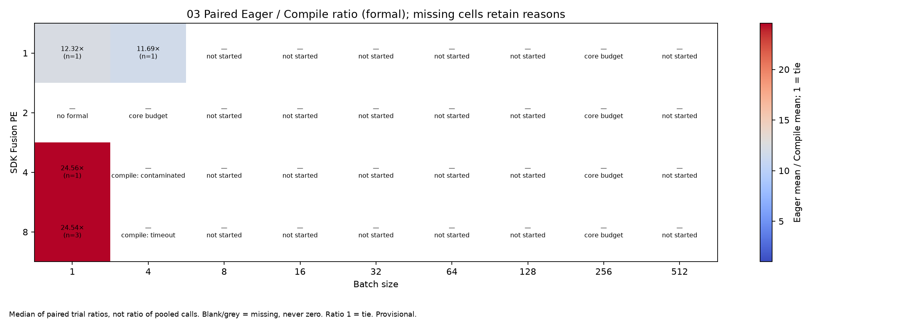
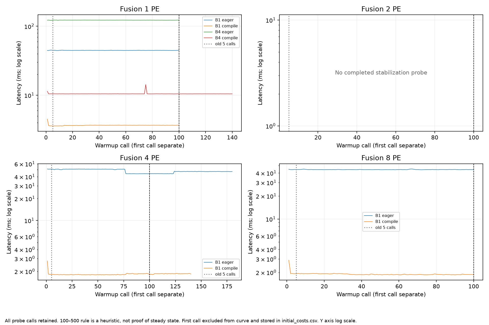

# ViT Eager vs torch.compile: RNGD PE·배치 확장 중간 보고서

원본 run: **20261118T081725Z-a6c274**  
작성 기준: **2026-11-19 00:19:13 KST / 2026-11-18 15:19:13 UTC**  
이 문서는 해당 시점까지 완료된 결과의 고정 스냅샷이다. 기준 시점에 원본 실험은 실행 중이었으며, 진행 중이던 4 PE·B1 Compile trial 2는 통계에서 제외했다. 이후 원본 결과가 늘어나도 이 문서의 기준 범위는 바뀌지 않는다.

**현재 결론:** Batch 1에서는 Compile의 반복 실행 이점이 확인됐지만, Eager의 PE 확장 이점은 관측되지 않았다. Compile 역시 PE 수에 비례해 빨라지지 않았다. 큰 배치 확장·전체 핵심 조건 3 trial·대표 5 trial·5분 안정성은 아직 완료되지 않았다. 수치 허용 기준이 pending이므로 아래 성능은 모두 **provisional**이며 배포 추천이 아니다.

## 1. 지금까지 확인한 핵심 결과

현재 규약으로 완료된 정식 측정은 **12개 mode trial**, 즉 Eager/Compile **6쌍**이다. 8 PE·B1만 양쪽 3 trial을 완료했고, 1 PE·B1/B4 및 4 PE·B1은 양쪽 각 1 trial이다.

|PE|Batch|Mode|trial n|공통 warmup|trial 평균 중앙값 ms|trial 평균 최소–최대 ms|중앙 images/s|images/s/할당 PE|
|---|---|---|---|---|---|---|---|---|
|1|1|compile|1|[100]|3.671|3.671–3.671|272.39|272.39|
|1|1|eager|1|[100]|45.213|45.213–45.213|22.12|22.12|
|1|4|compile|1|[140]|10.479|10.479–10.479|381.72|381.72|
|1|4|eager|1|[140]|122.502|122.502–122.502|32.65|32.65|
|4|1|compile|1|[180]|1.830|1.830–1.830|546.32|136.58|
|4|1|eager|1|[180]|44.954|44.954–44.954|22.24|5.56|
|8|1|compile|3|[100]|1.890|1.877–1.910|529.06|66.13|
|8|1|eager|3|[100]|46.380|45.204–46.768|21.56|2.70|

값은 독립 trial 평균 또는 trial 처리량의 중앙값이다. n=1의 최소–최대가 같은 것은 재현성이 확인됐다는 뜻이 아니다. 범위는 신뢰구간이 아니다.

- 관측 최고 정식 처리량은 **4 PE·B1 Compile 546.32 images/s**다. 1 trial 결과이며, 8 PE·B1의 3 trial 중앙값 **529.06 images/s**보다 약 3.3% 높다. 이 차이로 PE4의 우위를 확정하지 않는다.
- 관측 최고 PE당 처리량은 **1 PE·B4 Compile 381.72 images/s/할당 PE**다. 배치와 PE가 모두 다른 조건의 보조 지표이며 장치 활용률 측정값이 아니다.
- 1 PE 기준의 같은 trial index와 비교한 B1 Compile speedup은 **4 PE 2.006배**, **8 PE 1.942배**다. Eager는 각각 **1.006배**, **0.975배**다. 8 PE Eager의 성능 저하도 그대로 남겼다. 1 PE 기준이 아직 1 trial이므로 이 scaling 비교는 각각 n=1이다.
- B1에서 Eager/Compile 배속은 1 PE **12.316배(n=1)**, 4 PE **24.560배(n=1)**, 8 PE **24.538배(n=3)**다. Compile의 장점이 커졌지만, 진단의 실제 다중 PE 활용 근거에는 아래와 같은 제한이 남아 있다.

## 2. 실행 범위와 미완료 범위

|요청/SDK PE|B1: Eager/Compile trial|B4 상태|B8–128|B256/512|
|---|---|---|---|---|
|1|1/1|정식 1/1|미측정|확대 선행 조건 미충족|
|2|0/0; 기존 탐색·진단 있음|정식·출력 미측정|미측정|확대 선행 조건 미충족|
|4|1/1|양쪽 출력 검증 있음; 정식 0/0|미측정|확대 선행 조건 미충족|
|8|3/3|Eager 탐색만 완료; Compile 검증 timeout|하위 배치 timeout 이후 확대 보류|보류|

8 PE·B4 Eager 탐색은 별도 first 1 + warmup 20 + repeat 50 규약으로 완료됐다. 평균 **122.0975 ms**, **32.7607 images/s**, 반복 측정 합계 **6.1049초**이며 정식 통계에 합치지 않는다. 정식 1 PE·B4와 동일 규약의 scaling 비교로 쓰지 않는다.

8 PE·B4 Compile 출력 검증은 worker 제한 3600초로 종료됐다. 종료 정리를 포함한 wall 시간은 약 3621.5초이며 완료된 첫 호출 F·출력·반복 성능은 없다. 이를 SDK 미지원이나 처리량 0으로 기록하지 않았다. 4 PE·B4는 양쪽 finite 출력까지 확보했으나 Compile 탐색 중 장치 PID 식별 문제로 contaminated attempt가 생겨 정식 측정은 미완료다.

요청 최소 핵심인 각 PE의 B1/4/16 및 공통 큰 배치는 아직 충족하지 못했다. 모든 PE에서 공통으로 양쪽 호출을 확인한 탐색 최대 배치는 B1이다. B1을 큰 배치로 간주하지 않는다. B8 이상 입력은 사전에 만들어 두었지만 측정 결과는 없다. B256/512는 B128 성공 등의 선행 조건도 충족되지 않았다.

## 3. 고정 환경·입력·측정 규약

|항목|확인 내용|
|---|---|
|장치|RNGD npu0, PCI 0000:03:00.0, 메모리 표시 47.50 GiB|
|SDK 계열|furiosa-torch / furiosa-kernels / SMI / driver / firmware 2026.4.0|
|소프트웨어|Python 3.12.3, torch 2.10.0+cpu, torchvision 0.25.0+cpu; Furiosa PrivateUse1 확장 사용|
|모델|torchvision.models.vit_b_16, ViT_B_16_Weights.IMAGENET1K_V1|
|실행|224×224, BF16, eval, inference_mode; 기존 모델 구조·가중치 유지|
|공통 제어|MHA fastpath=False, SDK cpu_fallback=False; strict control을 worker 전후 기록|
|Compile|기존 검증 Furiosa backend만 지정; dynamic/fullgraph/mode/options/recompile_limit 조정 없음|
|CPU 설정|torch threads 22 / inter-op threads 64 고정|
|독립 trial|새 프로세스·모델·runner·조건별 전용 cache_context; NPU worker 직렬|
|순서|seed 20261118, 균형 순서; 실제 명령·시각·PID는 manifest|
|반복|최소 500회이면서 timed sum ≥10초, 상한 10000회|

기존 실제 이미지 cat → coffee → astronaut → rocket과 전처리를 재사용했다. 배치 원소 i는 원본 i%4로 구성했다. B1의 unique_image_count는 1, B4 이상은 4다. 동일 배치 입력 해시를 mode·PE 사이에 대조했으며, 이는 고정 입력 성능 실험이다. 반복 이미지는 독립 정확도 표본이 아니다. 프로젝트에서 추가 실제 이미지를 검색했으나 기존 네 장 외의 입력은 도입하지 않았다.

|식별 대상|SHA256|
|---|---|
|원본 weights 파일|c867db91d3e12c6cbadabb610d73c24a546bf82d8c03a9fea34f43a712ddb0e9|
|CPU BF16 state_dict|4a1c8a59001eee9cc34e4b396860819d40c3badd62f91b06133ee79c5455c396|
|원본 전처리 BF16 파일|4896db25d7de29a9a24694d6db1c93ec5d58d4eca4a3193623b64a27494ad728|
|B1 tensor|08b52c5a2a27fe6d0e20fa7d2d99a1c8cf03671ba9c0d51f7ff2490732c33d23|
|B4 tensor|e943285ad3e9668d6e3a6466aae88f6e2697109336cbfe4aed83cae62579b7f7|
|현재 성능 worker v2|d1e544f811d86da8700fed9092681d7d8b0085293ba50a551e9cee8602b86906|

모든 후보 배치의 원소 순서·파일 경로·tensor hash는 [assets.json](assets.json), 환경과 설치 소스 식별은 [environment.json](environment.json), [evidence/](evidence/), 실행 코드 버전은 [code/](code/)에 있다. BF16은 모델·입출력 dtype이며 SDK 기본 implicit casting을 유지했으므로 모든 내부 연산 dtype까지 BF16이라고 보장하지 않는다.

## 4. PE API와 실제 사용 근거

설치 SDK의 공식 stub에서 확인한 API는 <code>furiosa.torch.set_fusion(P)</code>다. 새 프로세스에서 장치 생성·stream/device 조회·모델 이동·Compile 전에 한 번 설정한다. Eager와 Compile 모두 같은 Fusion 설정 후 동일 fused logical device 하나로 모델을 이동하고 호출했다.

|요청 PE|SDK num_fusion|PE/cluster|cluster/chip|관측 논리 장치 수|문서상 방식|
|---|---|---|---|---|---|
|1|1|1|1|8|hardware fusion|
|2|2|2|1|4|hardware fusion|
|4|4|4|1|2|hardware fusion|
|8|8|4|2|1|software fusion, 단일 chip|

Python 모델 인스턴스 하나와 입력 호출 하나를 사용했다. 별도 모델 replica·여러 프로세스 데이터 병렬·Furiosa-LLM tensor_parallel_size는 구성하지 않았다. 8 PE software fusion 내부의 tensor 분할 또는 가중치 복제 방식은 공개 설치 소스에서 확인하지 못했다.

설치 runnable 소스는 expected_num_fusion과 현재 Fusion의 일치를 검사한다. PE 변경 전후 산출물 호환을 가정하지 않고 mode·PE·batch·trial·attempt별 새 cache_context를 썼다. 새 경로가 실제 codegen이나 disk miss를 뜻하지는 않는다.

|PE|Mode|Batch|NPU task|cluster|backend 진입|graph-break 로그 줄|recompile 로그 줄|
|---|---|---|---|---|---|---|---|
|1|compile|1|2|0|1|0|0|
|1|eager|1|185|0|0|0|0|
|2|compile|1|0|미관측|1|0|0|
|2|eager|1|185|0|0|0|0|
|4|compile|1|0|미관측|1|0|0|
|4|eager|1|184|0|0|0|0|
|8|compile|1|0|미관측|1|0|0|
|8|eager|1|368|0,1|0|0|0|

위 표는 별도 진단 worker만의 관측이다. 양쪽 native MHA host 관측 수는 0이었다. graph-break/recompile 로그 줄이 없었다는 사실은 내부 컴파일·재컴파일이 없었다는 증명이 아니다. backend 진입 역시 실제 codegen 횟수가 아니다.

Eager에서는 1/2/4 PE 구성에 대응하는 task 이름을, 8 PE에서는 cluster 0과 1의 task를 관측했다. 최신 오염 없는 Compile 진단의 task는 1 PE에서만 관측됐고, 2/4/8 PE에서는 0개였다. 해당 구성의 SDK 할당·host stream launch·finite 출력은 확보했으나 **Compile의 실제 PE별 활용은 unverified**다. task 0을 NPU 미실행으로 해석하지 않으며 task 수를 커널 수·fusion 횟수로 바꾸지 않는다. 모든 구성의 PE별 사용률과 작업 균형은 미확인이다.

측정 경계는 기존 timed_call의 **stream synchronize → perf_counter_ns → runner(inputs) → synchronize → 종료**를 재사용했다. 모델·입력 준비, 출력 CPU 복사·파일 저장·상세 profiler는 타이머 밖이고 성능 반복 중 CPU 출력 복사는 없다. SDK는 동일 logical device current stream에 제출한 모든 작업 완료를 synchronize가 기다린다고 문서화한다. 다중 PE binary 내부 barrier는 독립 검증하지 못했으므로, 시간은 이 계약에 의존한 동기화된 모델 호출 관측이다. 모든 PE의 물리 완료를 독립 증명한 순수 NPU kernel 시간으로 확정하지 않는다.

근거 위치와 원문은 [pe_configuration.md](pe_configuration.md), [pe_observations.csv](pe_observations.csv), [diagnostic_summary.json](diagnostic_summary.json), 각 diagnostic case의 trace에 있다.

## 5. RQ1·RQ3: PE scaling과 Compile 이점

|PE|Batch|paired trial n|Eager/Compile 중앙값|최소–최대|
|---|---|---|---|---|
|1|1|1|12.316|12.316–12.316|
|1|4|1|11.690|11.690–11.690|
|4|1|1|24.560|24.560–24.560|
|8|1|3|24.538|23.666–24.913|

|PE|Batch|Mode|paired index|1PE/P PE 시간 비율|상대 효율|관측 활용률|
|---|---|---|---|---|---|---|
|8|1|compile|1|1.942|0.243|미확인|
|8|1|eager|1|0.975|0.122|미확인|
|4|1|eager|1|1.006|0.251|미확인|
|4|1|compile|1|2.006|0.501|미확인|

Eager/Compile 비율은 같은 PE·batch·trial index의 두 평균을 나눴다. PE scaling은 같은 mode·batch·trial index의 유효 1 PE 기준만 썼다. 현재 B1 scaling의 기준은 t1 한 번이며 시간상 인접한 측정은 아니다. 다른 시각의 부하·실행 상태 영향이 남을 수 있다.

상대 효율은 speedup/P다. 예를 들어 4 PE Compile의 0.501은 이 실험의 성능 비율이며 “하드웨어 50.1% 사용률”이 아니다. 누락된 2 PE 정식 지점을 보간하지 않았다.

## 6. RQ2: 배치 증가

현재 정식 배치 증가 비교가 가능한 것은 1 PE B1→B4 한 쌍뿐이다. Compile은 처리량 **272.39→381.72 images/s, 약 1.401배**, batch-call 지연시간 **3.671→10.479 ms**였다. Eager는 **22.12→32.65 images/s, 약 1.476배**, **45.213→122.502 ms**였다.

Compile의 amortized 시간은 약 3.671→2.620 ms/image, Eager는 45.213→30.626 ms/image다. 이 값은 batch latency를 batch로 나눈 처리 비용이며 개별 요청 응답시간이 아니다. 각 조건 n=1이고 B8 이상은 미측정이므로 처리량 포화점·큰 배치의 PE 이점은 아직 답할 수 없다.

## 7. RQ4: 워밍업과 재현성

첫 호출은 따로 기록하고 안정화 탐색은 최소 100회부터 시작했다. 최근 20회씩 3개 연속 구간의 평균 max/min−1 ≤2%, 각 구간 CV≤0.05를 보조 휴리스틱으로 썼다. 실패 시 20회씩, 최대 500회까지 늘리는 구현이다. 이 기준은 steady state의 통계적 증명이 아니다.

|PE|Batch|Eager probe 횟수|Compile probe 횟수|정식 공통 횟수|
|---|---|---|---|---|
|1|1|100|100|100|
|1|4|100|140|140|
|4|1|180|140|180|
|8|1|100|100|100|

1 PE·B4 Compile은 100/120회 판정에서 한 구간 CV가 약 0.0796으로 기준을 넘었고 140회에서 충족했다. 4 PE·B1 Compile은 구간 평균 변화가 각각 약 2.99%/2.24%로 100/120회 판정을 넘어서 140회가 필요했다. Eager는 여러 구간의 수준 변화 때문에 180회에서 충족했다. 같은 PE·batch의 두 mode에는 그 최댓값을 모든 정식 trial의 고정 warmup으로 적용했다.

완료된 현재 규약 probe 중 500회 상한까지 불명확한 경우는 없었다. 미측정 조건에 일반화할 수 없다. 특히 4 PE Eager probe 마지막 구간은 약 47 ms인 반면 별도 정식 t1 평균은 44.954 ms였다. probe의 안정화 판정이 다음 독립 프로세스의 동일한 수준을 보장하지 않음을 보여준다.

8 PE·B1의 독립 trial 평균은 Eager **45.204–46.768 ms, CV 1.766%**, Compile **1.877–1.910 ms, CV 0.874%**였다. Eager/Compile paired 배속은 **23.666–24.913배**다. 가장 빠른 trial을 골라 대표값으로 쓰지 않았다.

반면 Compile 8 PE t1/t2의 **호출별 CV는 각각 8.008%/8.365%**였다. 독립 trial 평균의 작은 CV와 호출별 변동을 구분해야 한다. 느린 호출을 제거하지 않았다. 아래 p95/p99도 각 trial 내 실제 호출 표본에 한정한다.

|PE/B/Mode/trial|warmup|반복 n|측정 합계 s|평균 ms|중앙값 ms|표본 SD ms|CV %|p95 ms|p99 ms|
|---|---|---|---|---|---|---|---|---|---|
|1/1/compile/t1|100|2724|10.000|3.6712|3.6689|0.0725|1.98|3.6919|3.7048|
|1/1/eager/t1|100|500|22.607|45.2133|45.3663|0.3860|0.85|45.5976|46.0932|
|1/4/compile/t1|140|955|10.007|10.4789|10.4774|0.0228|0.22|10.4948|10.5083|
|1/4/eager/t1|140|500|61.251|122.5022|122.3256|5.3042|4.33|122.6022|122.7724|
|4/1/compile/t1|180|5464|10.001|1.8304|1.8214|0.0587|3.21|1.8841|1.9001|
|4/1/eager/t1|180|500|22.477|44.9542|45.0504|0.3353|0.75|45.3116|45.4008|
|8/1/compile/t1|100|5291|10.001|1.8901|1.8823|0.1514|8.01|1.9050|1.9296|
|8/1/compile/t2|100|5236|10.001|1.9101|1.9064|0.1598|8.36|1.9466|1.9619|
|8/1/compile/t3|100|5328|10.002|1.8772|1.8608|0.0613|3.27|1.9377|1.9524|
|8/1/eager/t1|100|500|23.190|46.3799|45.4436|1.3985|3.02|48.5269|48.7812|
|8/1/eager/t2|100|500|22.602|45.2041|45.4810|0.5643|1.25|45.7952|45.9884|
|8/1/eager/t3|100|500|23.384|46.7677|45.8414|1.6249|3.47|48.6074|48.7358|

표의 p95/p99는 해당 행의 반복 n개, “측정 합계 s” 범위에서 계산한 선형 보간 표본 분위수다. 이를 독립 trial 수나 신뢰구간으로 해석하지 않는다. [trial_summary.csv](trial_summary.csv)에는 실행 경로·출력·안정화 상태와 원본 case ID도 있다.

기존 warmup 5회가 모든 조건에서 충분했다고 볼 수 없다. 새 곡선의 4 PE Eager는 5회 이후에도 수준 변화가 관측됐다. 다만 과거와 물리 장치·측정일·반복 규약이 달라 이전 수치 차이를 워밍업 효과만으로 설명하지 않는다. **대표 조건 5 trial 및 모드별 5분 stability는 기준 시점에 미완료**다.

## 8. RQ5: 첫 호출과 준비 비용

아래는 정식 trial별 비용의 중앙값이다. 준비는 모델·입력 준비와 이동, S는 runner/Compile wrapper 생성, F는 동기화된 첫 호출, W는 공통 warmup 합계다. **F를 순수 compiler 시간으로 부르지 않는다.**

|PE/B/Mode|trial n|준비 s|S s|F s|W s|A s|
|---|---|---|---|---|---|---|
|1/1/compile|1|1.512|0.140082|199.511|0.368|200.019|
|1/1/eager|1|1.200|0.000005|97.959|4.488|102.447|
|1/4/compile|1|1.187|0.145319|440.916|1.468|442.529|
|1/4/eager|1|1.529|0.000003|166.527|17.078|183.605|
|4/1/compile|1|1.882|0.144063|204.733|0.328|205.204|
|4/1/eager|1|1.869|0.000005|121.352|8.039|129.392|
|8/1/compile|3|1.909|0.144195|460.719|0.190|461.054|
|8/1/eager|3|1.928|0.000004|369.418|4.520|373.856|

A=S+F+W로 두면, 이번 정책의 warmup을 이미 수행한 뒤의 시나리오다. 모델·입력 준비는 A와 별도이며 warmup도 실제 forward다. 새 프로세스는 시스템 전체 cold가 아니고, 전용 cache 경로도 disk miss 증명이 아니다. codegen 횟수·disk hit/miss·순수 compiler 시간은 null이다.

동일 paired trial에서 A와 반복 평균을 결합한 선형 추정 손익분기는 다음과 같다. N은 준비 후 유효 batch 호출 수이며 유효 이미지는 B×N이다.

|PE|Batch|paired trial n|추정 N 중앙값|N 최소–최대|유효 이미지 B×N 중앙값|
|---|---|---|---|---|---|
|1|1|1|2349|2349–2349|2349|
|1|4|1|2312|2312–2312|9248|
|4|1|1|1759|1759–1759|1759|
|8|1|3|1989|1869–2050|1989|

범위는 trial별 추정의 최소–최대이며 신뢰구간이 아니다. 수천 회 누적 손익분기 검증은 수행하지 않았다. 기존 warmup 5회의 경계와 직접 동일시하지 않는다. 큰 초기 비용을 반복 성능 그래프와 별도 그림으로 분리했다.

## 9. 출력 검증

별도 diagnostic/validation에서 shape [B,1000], finite 여부, 입력 해시 일치를 확인한 **13개 출력**과 **20개 비교 관계**를 보존했다. 그중 Eager/Compile 비교는 다음과 같다.

|PE|Batch|unique images|max abs|mean abs|최소 cosine|Top-1 일치|
|---|---|---|---|---|---|---|
|1|1|1|0.031250|0.004590|0.99994028|1/1|
|1|4|4|0.062500|0.005142|0.99991667|4/4|
|2|1|1|0.031250|0.004009|0.99995768|1/1|
|4|1|1|0.031250|0.003877|0.99995857|1/1|
|4|4|4|0.046875|0.005027|0.99991316|4/4|
|8|1|1|0.031250|0.004322|0.99994946|1/1|

NaN/Inf 또는 구조 오류는 완료된 별도 검증 출력에서 관측되지 않았다. 모든 성능 반복 출력에 대해 finite 검사를 수행했다는 뜻은 아니다. 8 PE B4 Compile은 timeout으로 비교 출력이 없다.

1 PE↔다중 PE 비교에서는 완료된 B1/B4 비교의 최대 절대 오차가 최대 0.0625였고 Top-1은 비교한 이미지에서 일치했다. B1↔B4는 cat 첫 이미지 한 장만 비교했으며 최대 절대 오차 0.03125, Top-1 1/1 일치였다. 같은 이미지를 반복하거나 여러 PE에서 다시 비교한 것을 독립 표본 수로 더하지 않았다.

**수치 허용 기준은 계속 pending**이다. 위 결과는 관측 통계이며 수치 검증 합격·모델 정확도 평가·배포 가능 판정이 아니다. 원본은 [output_validation.json](output_validation.json), 독립 출력 tensor는 각 [cases/](cases/)에 있다.

## 10. 장치 관측·예산·실행 문제

furiosa-smi info/status/ps를 worker 경계 및 약 30초 간격으로 수집했다. 스냅샷에는 765개 장치 관측이 있으며, 수집 범위 전체의 온도는 **36.24–43.26°C**, 표시 전력은 **37–68 W**였다. 이 범위는 준비·진단·idle도 포함하므로 정식 반복만의 평균이 아니다. utilization은 '-'로 표시되어 미확인이다. 시간 변화와 온도·전력의 인과 관계나 thermal throttling을 확정하지 않는다.

기준 시점의 전체 wall elapsed는 **7.030/12시간**, 잔여 예산은 **4.970시간**이다. 원본 12시간 기한은 **2026-11-19 05:17:25 KST**다. 완료·종료 worker wall 합계는 약 **5.713시간**이다. raw에 완료 시간으로 기록된 첫 호출 합계는 약 **4.462시간**, warmup 합계 약 **123.3초**, 탐색·정식 반복 합계 약 **362.0초**다. 이 phase 합계는 보존된 이전 규약·재시도도 포함하며 진행 중 첫 호출과 timeout 미완료 호출은 포함하지 않는다. 순수 compiler 비용은 분리 확인되지 않았다.

manifest의 56개 worker 상태는 완료 ok 52, contaminated 2, timeout 1, running 1이다. ok 수를 정식 독립 trial 수로 세지 않는다. raw timings는 36,769행이며 준비·first·warmup·exploration·legacy를 정식 반복과 분리했다.

원래 계획 전체가 아직 실행되지 못한 이유도 기록한다.

1. SDK import가 furiosa_torch Python logger를 DEBUG로 지정해 첫 호출에 상세 로그가 남는 문제를 발견했다. 원본 worker v1과 결과를 보존하고, v2에서는 성능 worker의 해당 logger를 WARNING으로 명시했다. 모델·정밀도·backend·timed_call은 바꾸지 않았다. **v1 성능 결과는 현재 집계·최고 처리량·배속에서 제외**했고 기준점을 재측정했다. v1 탐색은 실행 가능성과 대략 비용 참고로만 남겼다.
2. 초기 controller 종료를 분리 supervisor로 보완했다. 2 PE Compile 첫 진단에서는 자기 compiler 자식 PID를 외부 점유로 오인해 contaminated로 남기고, 계보 확인을 보강한 뒤 새 attempt로 재실행했다.
3. 4 PE B4 Compile 탐색 중 PID267156가 조회 직후 사라져 소유를 확인하지 못했다. 타인 또는 자기 compiler라고 단정하지 않고 contaminated로 보존했다. 이후 SMI 조회 중에만 /proc PID identity 관측을 보강했다. 타인 프로세스 종료·장치 reset은 하지 않았다.
4. 도구 접근의 자동 승인 시간 초과와 장치 안전 보류로 중단·대기 시간이 발생했다. 8 PE B4 Compile의 한 시간 timeout과 재측정도 최초 생성 시각부터의 12시간 wall 예산을 사용했다.
5. 남은 시간에는 비교 가능한 핵심 조건 3 trial을 먼저 확보하도록 배분했다. B16 이상 frontier와 대표5·stability는 추정 완료 시간에 맞춰 진행하는 상태다. 미측정 큰 배치를 SDK 미지원이나 자원 부족으로 판정하지 않았다.

실행 문제는 [logs/](logs/), 전체 순서·PID·명령은 [manifest.json](manifest.json), 잔여·phase 비용은 [budget_accounting.json](budget_accounting.json), 누락 사유는 [coverage.csv](coverage.csv)에 있다.

## 11. 기존 최종 실험과 기준점 비교

이전 run은 20261104T172746Z-e1b86b다. 이전은 npu1 PCI04:00.0, 이번은 npu0 PCI03:00.0으로 장치 식별이 다르다. 입력·가중치와 strict 실행 조건은 유지했고 과거 수치에 맞추려는 설정 조정은 하지 않았다.

|Batch|Mode|이전 n|이전 중앙값 ms|현재 n|현재 중앙값 ms|현재/이전 변화 %|
|---|---|---|---|---|---|---|
|1|compile|3|3.6367|1|3.6712|0.95|
|1|eager|3|44.7699|1|45.2133|0.99|
|4|compile|3|10.4780|1|10.4789|0.01|
|4|eager|3|122.4818|1|122.5022|0.02|

이전 각 3 trial과 현재 각 1 trial의 기술적 비교다. B1은 약 1%, B4는 약 0.02% 이내 차이지만 동일 환경에서의 인과 실험이나 통계적 동등성 판정은 아니다. 이전 warmup5/repeat50과 이번 공통 warmup≥100/repeat≥500 및≥10초의 차이도 함께 고려해야 한다.

## 12. 그림과 대응 원본 CSV

미측정 지점은 빈칸·사유로 표시했다. 곡선은 누락 조건을 연결해 보간하지 않는다. 8번은 완료된 300초 자료가 없어 빈 패널로 제공한다. 초기 비용은 9번으로 분리했다.

|번호|그림|원본 CSV와 해석 범위|
|---|---|---|
|1|[PE별 batch 처리량](figures/01_throughput.png)|[CSV](figures/01_throughput.csv); formal과 exploration 별도, batch x축 log|
|2|[PE별 batch-call 지연시간](figures/02_batch_latency.png)|[CSV](figures/02_batch_latency.csv); batch x축 log|
|3|[Eager/Compile 배속 heatmap](figures/03_eager_compile_heatmap.png)|[CSV](figures/03_eager_compile_heatmap.csv); 1=동률, paired n과 누락 사유|
|4|[PE scaling speedup](figures/04_pe_scaling.png)|[CSV](figures/04_pe_scaling.csv); 1 기준선, 유효 1PE paired 기준만|
|5|[상대 scaling 효율](figures/05_relative_efficiency.png)|[CSV](figures/05_relative_efficiency.csv); 1 기준선, 실제 utilization 아님|
|6|[warmup 지연시간 곡선](figures/06_warmup_curves.png)|[CSV](figures/06_warmup_curves.csv); y축 log, first 별도, 5/100회 기준 표시|
|7|[독립 trial 평균 분포](figures/07_trial_means.png)|[CSV](figures/07_trial_means.csv); x/y log, 모든 완료 trial 표시|
|8|[장시간 추세](figures/08_stability_trend.png)|[CSV](figures/08_stability_trend.csv); 완료 자료 없음, 안정성 결론 없음|
|9|[초기 비용](figures/09_initial_costs.png)|[CSV](figures/09_initial_costs.csv); x/y log, A=S+F+W|

## 13. 증거 수준 구분

|구분|현재 말할 수 있는 내용|
|---|---|
|① 실행으로 확인됨|기록된 PE 할당, 입력/weights/state 해시, strict controls, 완료 출력 shape/finite, 원본 호출 시간, 조건별 trial 수, 8PE B4 Compile timeout|
|② 설치 문서·소스로 확인됨|set_fusion 설정 시점, hardware/software fusion 구성, expected_num_fusion 검사, logical current stream synchronize 계약|
|③ 조건부 추정|초기 비용 선형 손익분기, 다른 시각의 trial index를 맞춘 scaling, 대략 비용 기반 향후 예산 예측|
|④ 아직 미확인|Compile 다중PE의 실제 활용·PE별 균형, 모든 op placement, binary 내부 전체 PE barrier, codegen/cache hit·miss/순수 compiler 시간, 수치 허용 기준, 큰 배치 포화점, 5분 안정성|

## 14. 요청한 마지막 질문에 대한 답

1. **실제 비교 범위:** 현재 규약 정식 Eager/Compile은 1 PE B1/B4, 4 PE B1 각 1쌍, 8 PE B1 3쌍이다. 2 PE는 진단·이전 규약 탐색까지이며 정식 비교는 미완료다.
2. **작은/큰 배치의 다중 PE 효과:** B1 Compile은 4/8 PE에서 1 PE 대비 약 2배, Eager는 거의 같거나 느렸다. 큰 배치의 동일 규약 PE 비교는 없어 답할 수 없다.
3. **최고 처리량:** 완료 formal 조건 중앙값 기준 4 PE B1 Compile 546.32 images/s(n=1). 충분한 trial로 확정된 최적 조건이 아니다.
4. **PE당 효율:** 관측 formal 처리량/할당 PE는 1 PE B4 Compile 381.72가 최고다. B1 상대 scaling 효율은 4 PE Compile 약 0.501, 8 PE 약 0.243(n=1)이다.
5. **Eager/Compile 차이:** 1 PE B1 약 12.316배, B4 약 11.690배; 4 PE B1 약 24.560배; 8 PE B1 중앙값 24.538배다. 누락 배치로 일반화하지 않는다.
6. **100회 초과 warmup:** 1 PE B4 Compile 140회, 4 PE B1 Compile 140회·Eager 180회가 probe에서 필요했다. 정식 공통 warmup은 각각 140/180회다.
7. **독립 trial·장시간 유지:** 8 PE B1의 3 trial 평균 CV는 Eager 1.766%, Compile 0.874%다. 호출별 CV가 더 큰 trial도 남겼다. 대표5 및 5분 안정성은 미완료다.
8. **출력·실행 경로 미확인:** 허용 오차 pending, Compile 다중PE task 미관측 원인·실제 PE 활용, 모든 op placement, 내부 동기화 상세, codegen/cache가 남아 있다.
9. **다음 추가 가치:** 현재 진행 중 핵심 조건 paired3 완료 후 1/4 PE B4와 가능한 B16 frontier를 우선하고, 출력 허용 기준 합의·다른 실제 이미지의 별도 검증·Compile 다중PE trace 누락 진단·대표 장시간 실행을 보강할 가치가 있다. 큰 배치 최적화 결론은 이를 확보한 뒤 판단해야 한다.

## 15. 산출물과 재현

이 스냅샷의 [README](README.md), [설정](experiment_config.json), [원본 timings](timings.csv), [trial summary](trial_summary.csv), [scaling summary](scaling_summary.csv), [초기 비용](initial_costs.csv), [출력 검증](output_validation.json), [진단](diagnostic_summary.json), [장치 상태](device_states.jsonl), [feedback_summary](feedback_summary.md), [자동 생성 기술 부록](technical_appendix.md)을 함께 보존했다.

완료/실패 case의 출력과 diagnostic trace는 로컬 복사했다. 입력 tensor·weights·전용 SDK cache는 원본 경로와 해시로 연결하며 대용량 캐시는 복제·삭제하지 않았다. manifest는 작성 기준 시각의 원본이고, running 상태는 **원본 실험이 그때 실행 중이었다는 뜻**이다. 이 스냅샷에서 성능 worker를 실행하거나 재개하지 않는다.

기준 시점에 실행 중인 원본 run은 supervisor가 관리한다. 나중에 종료 후 미완료 조건을 재개할 때 사용하는 단일 명령은 README에 제공했다. 이 보고서를 만들기 위해 NPU forward를 추가 실행하지 않았다.
